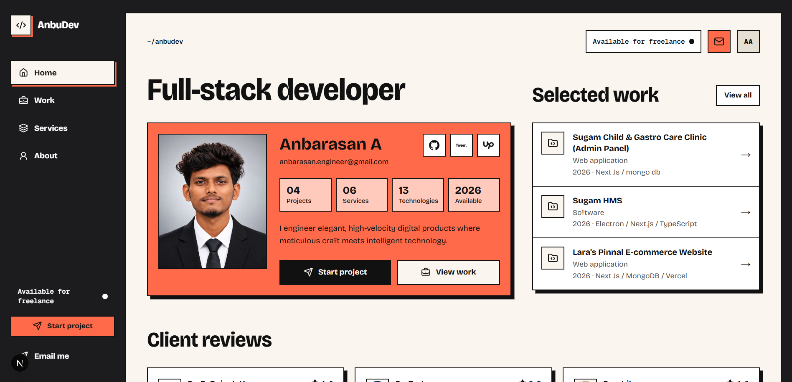

# AnbuTech ⚙️🧑‍💻 Freelance Portfolio
live link :https://anbutech.space/
A clean, brutalist portfolio for a freelance developer, built with Next.js (App Router), TypeScript and Tailwind CSS v4. It comes with a private admin panel, so you can edit every section of the site yourself without touching code.

Content lives in MongoDB, images are stored on ImageKit, and email goes out through Resend.



If you want to dig into the thinking behind it, there are two design documents:

- **Site design and engineering:** `freelancer_brutalist_portfolio_clean_minimal_master_spec.md`
- **Admin panel design:** `docs/superpowers/specs/2026-09-27-admin-panel-design.md`

---

## Getting started

Setting this up from scratch takes a few minutes.

1. **Add your environment variables.** Copy `.env.example` to `.env.local` and fill in every value. The [Environment](#environment) section below explains what each one does.
2. **Load the starting content.**
   ```bash
   npm run db:seed
   ```
3. **Create your admin account.** This uses `ADMIN_EMAIL` and `ADMIN_PASSWORD` from your env file.
   ```bash
   npm run admin:create
   ```
   Once it's done, remove `ADMIN_PASSWORD` from `.env.local`. You won't need it again unless you forget your password. If that happens, set a new one there and run the command again.
4. **Start the dev server.**
   ```bash
   npm run dev
   ```
   Open [http://localhost:3000](http://localhost:3000), then sign in at `/admin/login`.

---

## Commands

```bash
npm install
npm run dev           # start the site at http://localhost:3000
npm run lint          # check code style
npm run typecheck     # check types
npm test              # unit and repository tests (see note below)
npm run build         # production build (needs MONGODB_URI)
npm run db:seed       # import the original site content into MongoDB
npm run admin:create  # create the admin account, or reset its password
```

A few things worth knowing:

- **Tests** run against an in-memory MongoDB. The first run downloads a MongoDB binary, so it takes a little longer than usual.
- **Builds** read content from MongoDB, so your build environment needs `MONGODB_URI` set.
- **Seeding** is safe to re-run. It skips any collection that already has data.
- **Resetting the admin password** signs out every active session.

---

## The admin panel

Sign in at `/admin/login`. From there you can edit the whole site:

| Section | What it controls |
| --- | --- |
| **Settings** | Your brand (browser tab and logo), name, contact email, availability, portrait, resume, social links, about text, share-image text, the services clients can pick in "Start project", and the auto-reply message |
| **Projects** | Everything on `/work` and each case study: cover images, which projects are featured on the home page, and their order |
| **Services / Process** | The Services page |
| **Experience / Tech stack** | The About page. If you have no experience entries, that section simply hides itself |
| **Testimonials** | Client reviews on the home page, with publish and unpublish. If none are published, the section hides |
| **Inquiries** | Every "Start project" request. You can read, archive, and reply by email |
| **Account** | Change your password (this signs out your other devices) |

When you save, the affected public pages refresh right away. There's no need to redeploy.

A note on content: only publish real client feedback and real outcomes. If you don't have something yet, leave the field empty rather than making it up.

---

## Environment

| Variable | What it's for |
| --- | --- |
| `NEXT_PUBLIC_SITE_URL` | Your canonical URL. Used for metadata, the sitemap, structured data, and links in emails |
| `MONGODB_URI`, `MONGODB_DB` | Your MongoDB connection and database name. A free MongoDB Atlas cluster works fine |
| `SESSION_SECRET` | 32 or more random characters, used to sign admin sessions. Generate one with `openssl rand -base64 48` |
| `ADMIN_EMAIL`, `ADMIN_PASSWORD` | Only read by `npm run admin:create`. The password must be at least 12 characters |
| `IMAGEKIT_PUBLIC_KEY`, `IMAGEKIT_PRIVATE_KEY`, `IMAGEKIT_URL_ENDPOINT` | Found in ImageKit under Developer options. Uploads land in `/portfolio/...` in your media library |
| `RESEND_API_KEY` | Turns on email through [Resend](https://resend.com) |
| `CONTACT_TO_EMAIL` | The inbox that receives new project requests. Defaults to the email in Settings |
| `CONTACT_FROM_EMAIL` | A verified sender, for example `Portfolio <hello@your-domain.com>` (see the warning below) |

> **Heads up:** the domain in `CONTACT_FROM_EMAIL` must be verified in Resend. If it isn't, Resend will only deliver to your own address, and auto-replies to clients will fail.

---

## How project requests work

When someone submits the "Start project" form, the request is **saved to MongoDB first**. Then two emails go out:

1. A notification to you, with a link straight to the request in the admin.
2. An auto-reply to the client.

If an email fails, you won't lose the request. It stays saved and gets flagged **"Email failed"** in your inbox, so you can follow up yourself.

Without `RESEND_API_KEY`, emails are printed to your terminal in development. In production they fail, and the request is flagged as above.

---

## Images

Images upload straight from your browser to ImageKit. They must be actual images, up to 5 MB each. When you replace or delete an image, the old file is deleted too, so your media library stays tidy.

If you're using a custom ImageKit domain, add it to `images.remotePatterns` in `next.config.ts` so Next.js will load images from it.
